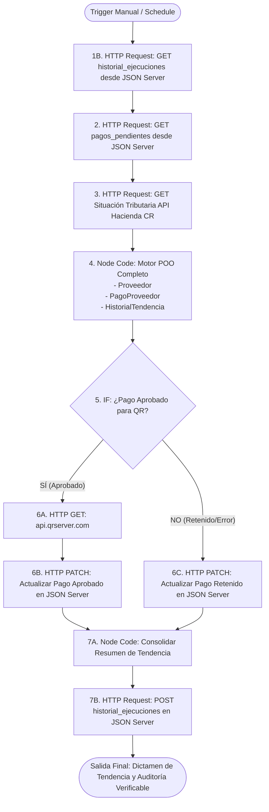

# Documento de Lógica de Negocio y Arquitectura
## Laboratorio #1: Soluciones de Negocio (POO + n8n)
### Escenario: Panel de Riesgo de Proveedores con Comprobante QR
### Extensión Implementada: Reto 4 — Historial y Tendencia Temporal

---

## 1. El Problema de Negocio y Justificación de la Extensión (Reto 4)

### 1.1. Contexto y Problemática Empresarial
En el departamento de Cuentas por Pagar y Gestión de Compras, auditar a los proveedores de forma aislada (factura por factura) permite frenar desembolsos ilegales en el presente, pero **no responde a las preguntas estratégicas de la alta dirección**:
- *¿Nuestra cartera de proveedores se está saneando o se está deteriorando con el tiempo?*
- *¿Las políticas preventivas de la empresa han logrado que los proveedores morosos se pongan al día con Hacienda?*
- *¿Cuál es la tendencia del capital financiero expuesto a retención o congelamiento por riesgo fiscal?*

Reportar únicamente el estado momentáneo de una corrida deja a la gerencia sin visión evolutiva.

### 1.2. Justificación y Beneficios del Reto 4
La extensión **Reto 4: Historial y tendencia** incorpora análisis cronológico y determinación automática de tendencia mediante Programación Orientada a Objetos en JavaScript:
1. **Memoria Histórica en JSON Server (`historial_ejecuciones`):** Cada ejecución del workflow almacena una instantánea con el número de proveedores evaluados, aprobados, retenidos, el porcentaje de riesgo y el monto total en riesgo.
2. **Determinación Dinámica de Tendencia (`HistorialTendencia`):** Una nueva clase POO compara los indicadores de la corrida actual contra el corte anterior, dictaminando matemáticamente si la situación está **`MEJORANDO`**, **`EMPEORANDO`** o **`ESTABLE`**.
3. **Conclusión Ejecutiva Automatizada:** El sistema redacta una conclusión sintética y profesional (ej. *"La situación está MEJORANDO: el porcentaje de pagos en riesgo bajó de 66.7% a 57.1% (-9.6 pts) respecto al corte anterior"*), entregada tanto en el resultado final del workflow como en el panel de control web.

---

## 2. Diagrama de Arquitectura y Recorrido de los Datos (Workflow n8n con Reto 4)



---

## 3. Clases POO y Responsabilidades de Negocio

La arquitectura mantiene el principio de responsabilidad única (SRP) y encapsulamiento estricto con campos privados (`#`):

### 3.1. Clase `Proveedor` ([classes/Proveedor.js](file:///c:/Users/HP8D1/OneDrive/Desktop/n8n/classes/Proveedor.js))
- **Responsabilidad:** Modela la identidad fiscal y el comportamiento ante el Ministerio de Hacienda.
- **Métodos Clave:**
  - `procesarRespuestaHacienda(res)`: Normaliza la respuesta y maneja errores 404, 500 y caídas de red (**Error #1**).
  - `estaEnRiesgo()`: Implementa la **Regla 1** (Moroso, Omiso, o no Inscrito).
  - `obtenerTasaRetencionBase()`: Determina la alícuota fiscal según el régimen tributario (**Regla 2**).

### 3.2. Clase `PagoProveedor` ([classes/PagoProveedor.js](file:///c:/Users/HP8D1/OneDrive/Desktop/n8n/classes/PagoProveedor.js))
- **Responsabilidad:** Gestiona el ciclo de vida del desembolso, validaciones, retenciones y comprobantes.
- **Métodos Clave:**
  - `validarIntegridadDatos()`: Detecta identificaciones vacías, montos `<= 0` y fechas corruptas (**Error #2**).
  - `calcularDiasRestantesYVencimiento()`: Aplica prioridades `URGENTE`, `ALTA` o `NORMAL` (**Regla 3**).
  - `calcularMontoNetoYRetencion()`: Calcula el 2% o 5% de retención según umbrales (**Regla 2**).
  - `evaluarDictamenPago()`: Dictamina aprobación directa o requerimiento de firma gerencial > $10,000 USD (**Regla 4**).
  - `generarPayloadQR()`: Construye la firma única `COMP-{id}-{cedula}-{fecha}` y la URL hacia `api.qrserver.com` (**Regla 5**).

### 3.3. Clase `HistorialTendencia` ([classes/HistorialTendencia.js](file:///c:/Users/HP8D1/OneDrive/Desktop/n8n/classes/HistorialTendencia.js)) — *Reto 4*
- **Responsabilidad:** Modela la inteligencia analítica temporal del sistema.
- **Constructor:** `constructor(historialPrevio = [], resultadosActuales = [])`.
- **Métodos Clave:**
  - `calcularMetricasEjecucionActual()`: Agrega el lote procesado calculando proveedores evaluados, aprobados, retenidos, el `porcentajeRiesgoActual` y el `montoTotalEnRiesgo`.
  - `determinarTendencia()`: Compara el `porcentajeRiesgoActual` con el último registro de `historialPrevio`:
    * Si la tasa de morosidad disminuyó: **`MEJORANDO`**.
    * Si la tasa de morosidad aumentó: **`EMPEORANDO`**.
    * Si se mantiene idéntica o no hay historial previo: **`ESTABLE`**.
  - `generarReporteYConclusion()`: Estructura el objeto para `POST /historial_ejecuciones` y redacta la conclusión en lenguaje natural para la gerencia.

---

## 4. Esquema de Datos de la Colección `historial_ejecuciones`

En `db.json`, la colección `historial_ejecuciones` sigue el siguiente estándar corporativo:

```json
{
  "id": "HIST-003",
  "fechaEjecucion": "2026-10-19T09:00:00.000Z",
  "totalProveedoresEvaluados": 6,
  "pagosAprobados": 2,
  "pagosRetenidosOError": 4,
  "porcentajeRiesgo": 66.7,
  "montoTotalEnRiesgo": 5300.00,
  "estadoTendencia": "EMPEORANDO",
  "conclusionTendencia": "La situación está EMPEORANDO: el porcentaje de pagos en riesgo aumentó de 50% a 66.7% (+16.7%) respecto al corte anterior."
}
```

---

## 5. Guía para la Demostración en Vivo del Reto 4 (Exposición Oral)

Para deslumbrar al evaluador en la defensa del Reto 4, sigue esta secuencia de 3 minutos:

### Paso 1: Demostración por Consola Independiente (`node main.js`)
1. Ejecuta en la terminal:
   ```bash
   node main.js
   ```
2. Muestra cómo, tras evaluar los 7 proveedores base, la consola imprime el bloque destacado:
   ```text
   ================================================================================
    RETO 4: HISTORIAL Y ANÁLISIS DE TENDENCIA DE RIESGO TEMPORAL
   ================================================================================
   Historial Previo Cargado (3 ejecuciones):
     - HIST-001: Riesgo = 60% | Tendencia = EMPEORANDO
     - HIST-002: Riesgo = 50% | Tendencia = MEJORANDO
     - HIST-003: Riesgo = 66.7% | Tendencia = EMPEORANDO

   >>> Comparación Temporal y Tendencia:
     • Porcentaje de Riesgo Anterior (HIST-003): 66.7%
     • Porcentaje de Riesgo Actual: 57.1%
     • Variación: -9.6 puntos porcentuales
     • Estado de la Tendencia: MEJORANDO

   >>> Conclusión Ejecutiva Generada:
     "La situación está MEJORANDO: el porcentaje de pagos en riesgo bajó de 66.7% a 57.1% (-9.6 pts) respecto al corte anterior (HIST-003)."
   ```

### Paso 2: Demostración en el Dashboard Web ([http://localhost:3000](http://localhost:3000))
1. Abre [http://localhost:3000](http://localhost:3000) en el navegador.
2. Señala el banner superior **"Evolución Temporal del Riesgo Tributario (Reto 4)"**:
   - Muestra el badge dinámico **`MEJORANDO`** en verde esmeralda.
   - Muestra la comparativa numérica: Corte Previo `66.7%` vs. Lote Actual `57.1%` (`-9.6 pts`).
3. Haz clic en la pestaña **"📊 Historial de Ejecuciones Registradas"**:
   - Observa la tabla con las ejecuciones cronológicas, fechas y estados de tendencia.
4. Haz clic en **"⚡ Ejecutar Motor POO + Reto 4"**:
   - Observa cómo se calcula la corrida, se agrega una nueva fila en el historial y se actualizan los contadores en tiempo real.

### Paso 3: Demostración del Workflow en n8n
1. Abre n8n en [http://localhost:5678/workflow/CUWXsiYAWklo8Tir](http://localhost:5678/workflow/CUWXsiYAWklo8Tir).
2. Haz clic en **"Execute workflow"**.
3. Observa cómo:
   - El nodo `1B. GET Historial Ejecuciones` lee los cortes anteriores.
   - El nodo `4. Code POO` ejecuta las 3 clases (`Proveedor`, `PagoProveedor`, `HistorialTendencia`).
   - El nodo `7B. POST Guardar Historial` persiste la nueva corrida en JSON Server.
   - El resultado final entrega el dictamen consolidado con la conclusión ejecutiva.
